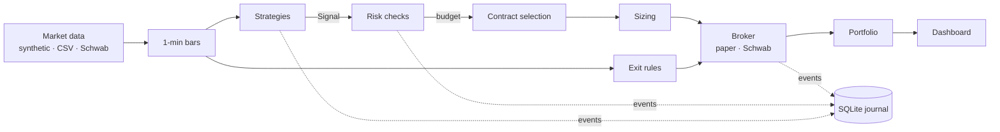

# OptionDesk

[](https://github.com/kalebhoffer/optiondesk/actions/workflows/ci.yml)
[](LICENSE)


**A starting point for building your own intraday options trading platform.**

OptionDesk is a small, readable, fully tested codebase that already does the
unglamorous parts: turning market data into bars, running strategies, applying
risk limits, choosing contracts, sizing positions, placing orders, managing
exits, keeping an audit trail, and showing it all on a dashboard. You bring the
strategy.

It trades long calls and puts on U.S. equities and ETFs. It runs in paper mode
out of the box with no account, and can use Charles Schwab for live data and
orders.

> **This is not financial advice and not a profitable strategy.** The included
> strategies are textbook examples that exist to exercise the pipeline. Options
> can lose 100% of the premium paid, quickly. Read [Live trading](#live-trading)
> before connecting real money. See the [license](LICENSE): the software is
> provided as-is, with no warranty.

## Try it in one minute

```bash
git clone https://github.com/kalebhoffer/optiondesk && cd optiondesk
uv sync            # or: python -m venv .venv && .venv/bin/pip install -e .
uv run optiondesk demo
```

`demo` backtests the two example strategies over ten days of synthetic SPY and
QQQ data and prints a report: P&L, drawdown, win rate, exit reasons, and why
signals were turned down. Add `-v` to see every trade.

To watch it trade live on the dashboard (still synthetic data, still paper):

```bash
uv run optiondesk run --config config/example.toml
# open http://127.0.0.1:8000
```

## How it works



Every completed bar goes through one loop in [`engine.py`](src/optiondesk/engine.py):

1. **Manage open positions.** Re-quote held contracts on that symbol and apply
   the exit rules: stop loss, take profit, trailing stop, maximum hold time,
   and flatten before the close. If a quote is missing, it waits for the next
   bar rather than exiting blind.
2. **Run strategies.** Each strategy sees the bar and may return a `Signal`:
   a symbol, a direction (long buys calls, short buys puts) and a reason.
3. **Check risk.** Market hours, no entries right after the open or near the
   close, daily loss limit, max open positions, one position per symbol,
   per-symbol cooldown, and total exposure. Approval comes with a dollar budget.
4. **Pick a contract.** Nearest expiration in the allowed DTE window, closest
   to the target delta, with a tight enough spread and enough open interest.
5. **Size it.** Fixed fraction of the budget, or fractional Kelly once a
   strategy has a track record (and zero if that record shows no edge).
6. **Place the order.** A limit just above the mid. The fill updates the
   portfolio.

Everything that happens is published on an in-process event bus and written
to a SQLite journal, so you can always answer "why did it do that?"

### Project layout

```
src/optiondesk/
  engine.py           the pipeline above
  strategies/         Strategy base class + two examples
  risk.py             pre-trade gates
  sizing.py           fixed fraction and fractional Kelly
  exits.py            exit rules
  options/            OCC symbols, Black-Scholes, contract selection
  data/               synthetic, CSV replay and Schwab market data
  broker/             paper broker and Schwab broker
  schwab.py           Schwab OAuth, token storage, authenticated requests
  portfolio.py        cash, positions, P&L
  journal.py          SQLite audit trail
  api.py              dashboard + JSON API
  backtest.py         same engine, simulated broker, results report
  config.py           TOML settings and environment secrets
```

## Write your own strategy

A strategy only decides *when* and *which way*. The engine handles everything
after that, so every strategy gets the same risk controls.

```python
# my_strategies.py
from optiondesk.indicators import RSI
from optiondesk.models import Bar, Direction, Signal
from optiondesk.strategies import Strategy, register


@register("rsi_reversal")
class RsiReversal(Strategy):
    @classmethod
    def defaults(cls):
        return {"period": 14, "low": 25, "high": 75}

    def __init__(self, **params):
        super().__init__(**params)
        self.rsi = {}

    def on_bar(self, bar: Bar) -> Signal | None:
        rsi = self.rsi.setdefault(bar.symbol, RSI(self.params["period"])).update(bar.close)
        if rsi is None:
            return None
        if rsi < self.params["low"]:
            direction = Direction.LONG
        elif rsi > self.params["high"]:
            direction = Direction.SHORT
        else:
            return None
        return Signal(self.name, bar.symbol, direction, bar.start, bar.close, f"RSI {rsi:.0f}")
```

Then list the module under `plugins` and enable the strategy in your config:

```toml
plugins = ["my_strategies"]   # finds ./my_strategies.py

[[strategies]]
name = "rsi_reversal"
params = { period = 14, low = 25, high = 75 }
```

Indicators available in [`indicators.py`](src/optiondesk/indicators.py): EMA,
RSI, ATR and session VWAP.

## Backtesting

```bash
# Synthetic data from your config's symbols
uv run optiondesk backtest --config config/example.toml --days 20

# Your own minute bars: timestamp,symbol,open,high,low,close,volume
uv run optiondesk backtest --config config/example.toml --csv my_bars.csv

# Generate a CSV in that format to see what it looks like
uv run optiondesk sample-data bars.csv --symbols SPY,QQQ --days 5
```

Backtests run the same engine as live trading with the paper broker. Option
prices are **modeled** with Black-Scholes at a fixed implied volatility, so they
miss volatility changes, skew and real spreads. Treat backtest results as a
check that the pipeline does what you intend, not as evidence of an edge. For
serious research, plug in historical option data by implementing the
`MarketData` interface in [`data/base.py`](src/optiondesk/data/base.py).

The paper broker is deliberately conservative: market orders fill at the far
side of the spread, and limit orders below the mid don't fill.

## Configuration

Settings live in a TOML file; [`config/example.toml`](config/example.toml)
documents every option. Copy it and edit:

```bash
cp config/example.toml config/my.toml
```

The loader rejects unknown settings (so typos fail loudly) and **refuses any
setting that looks like a credential**. Secrets only come from environment
variables:

```bash
cp .env.example .env    # git-ignored; OptionDesk reads it automatically
```

| Variable | Purpose |
|---|---|
| `SCHWAB_CLIENT_ID`, `SCHWAB_CLIENT_SECRET` | Your Schwab developer app |
| `SCHWAB_REDIRECT_URI` | Callback URL registered on that app (default `https://127.0.0.1:8182`) |
| `SCHWAB_ACCOUNT_NUMBER` | Which account to trade, if several are linked |
| `OPTIONDESK_TOKEN_PATH` | Where OAuth tokens are stored (default `~/.optiondesk/schwab_tokens.json`) |
| `OPTIONDESK_API_KEY` | Require this key on the dashboard and API |
| `OPTIONDESK_LIVE_TRADING` | Must be exactly `yes-i-understand` for live mode |

## Using Schwab

1. Create an app at [developer.schwab.com](https://developer.schwab.com) with
   the "Accounts and Trading Production" and "Market Data Production" APIs.
   Set its callback URL to `https://127.0.0.1:8182` (or your own, matching
   `SCHWAB_REDIRECT_URI`). Approval can take a few days.
2. Put the app key and secret in `.env`.
3. Log in:

   ```bash
   uv run optiondesk schwab-login
   ```

   Open the printed URL, approve access, and paste back the address your
   browser was redirected to (the page itself will fail to load; that's
   expected). Tokens are saved to a file only your user can read.
   **Schwab requires this login again every 7 days.**
4. Set `data = "schwab"` in your config and run. Strategies now see real
   one-minute bars built from five-second quote polls, and contracts are
   chosen from the real option chain. Orders still go to the paper broker.

## Live trading

Live mode sends real orders to your Schwab account. Before turning it on:

- Paper trade with `data = "schwab"` for long enough to trust what you see.
- Start with small limits: low `max_risk_per_trade_pct`, `max_contracts = 1`.
- Understand the limitations below.

Then set `mode = "live"` in your config **and**
`OPTIONDESK_LIVE_TRADING=yes-i-understand` in the environment. OptionDesk
refuses to start in live mode without both.

**Known limitations.** These are a good place to start building:

- **No position recovery.** Positions are tracked in memory. If the process
  stops, open positions stay open in your account and are *not* managed when
  it restarts (it warns you at startup if the account holds options).
- **Exits are market orders,** which guarantees getting out but not the price.
- **Equity in live mode starts from `account.starting_capital`**, not your
  actual account balance.
- **No holiday calendar or early closes.** Weekends are handled; exchange
  holidays are not.
- **Single-leg long options only.** No spreads, no short premium.
- **One process, one account.**

## Running with Docker

```bash
cp .env.example .env
docker compose up -d --build
# dashboard on http://127.0.0.1:8000
docker compose run --rm optiondesk optiondesk schwab-login   # if using Schwab
```

The dashboard port is published on the host's loopback address only. To reach
it from elsewhere, set `OPTIONDESK_API_KEY` and put a TLS reverse proxy (Caddy,
nginx) in front.

## Dashboard and API

The dashboard shows equity, today's P&L, open positions, recent trades and an
activity feed, and has a button to halt new entries (open positions keep
being managed).

| Endpoint | |
|---|---|
| `GET /health` | Liveness check (no key needed) |
| `GET /api/status` | Equity, P&L, exposure, mode |
| `GET /api/positions` | Open positions with marks |
| `GET /api/trades` | Closed trades |
| `GET /api/events` | Recent journal entries |
| `POST /api/halt`, `POST /api/resume` | Stop or allow new entries (needs header `X-OptionDesk: 1`) |

When `OPTIONDESK_API_KEY` is set, send it as `X-API-Key` or `?key=`.

## Development

```bash
uv sync
uv run pytest          # no network or account needed
uv run ruff check .
uv run mypy            # strict
```

Contributions are welcome; see [CONTRIBUTING.md](CONTRIBUTING.md). To report a
security problem, see [SECURITY.md](SECURITY.md).

## License

[MIT](LICENSE). Not affiliated with Charles Schwab.
